# Energy Consumption Pattern Analysis

A research prototype for finding recurring daily electricity-use shapes with synthetic and measured smart-meter data. The primary synthetic study separates consumption timing from total magnitude using a 51-feature behavioral representation, PCA, and K-Means.

[](https://energy-consumption-pattern.vercel.app)
[](https://energy-consumption-pattern-vqrh.streamlit.app/)

## Status and scope

This is an exploratory research project, not a utility operations system. The reproducible primary analysis uses generated household-like profiles with known archetypes. Separate scripts analyze an anonymized UCI load-diagram sample and a limited London smart-meter subset. Those measured-data analyses have no behavioral ground-truth labels.

The repository includes:

- A Python analysis pipeline and interactive Streamlit simulator.
- A Vite/React explorer deployed as a static Vercel site. It reads exported JSON and CSV artifacts; it does not run the Python model.
- An optional pybind11 C++ implementation of PCA and K-Means kernels. Python/scikit-learn remains the reference and fallback.
- Research scripts, reports, figures, a LaTeX manuscript, and automated tests.

## How the analysis works



Open the [standalone HTML source](docs/assets/research-pipeline-architecture.html) or the [implementation-level architecture and data-flow notes](docs/architecture.md).

Synthetic archetype labels are used only for post-fit checks. The UCI and London studies use separate ingestion scripts and have no behavioral ground truth. Streamlit runs selected analyses through Python; the Vercel explorer reads committed JSON and CSV artifacts without fitting models.

## Reference results

The committed reference configuration uses 200 synthetic consumers over 365 days, 51 behavioral features, 10 PCA components retaining 95.05% variance, and K=4. Its synthetic archetype recovery is ARI 0.813 and NMI 0.828. These values describe the generated data and are not estimates of real household classification accuracy.

Additional runs are documented in [outputs/reports/](outputs/reports/) and have code and machine-readable sidecars under [research/](research/) and [outputs/research_additions/](outputs/research_additions/).

Explore the [interactive load-shift test bench](https://energy-consumption-pattern.vercel.app/research/load-shift-test-rig.html) for one UCI counterfactual: at the assumed 10% shift, the evening peak falls by 5.64% while a larger whole-day peak appears at 16:00. The figure uses the saved hourly profile and does not represent observed participant response. See [technical visualizations](docs/visualizations.md) for its static fallback and scope.

| Analysis | Result | Interpretation |
|---|---|---|
| 365-day synthetic replication, 20 independent seeds | Behavioral features + PCA, fixed K=4: ARI 0.854 (95% seed-bootstrap interval 0.825–0.880). Normalized 24-bin baseline without PCA: 0.693 (0.655–0.732). Paired difference: 0.161 (0.125–0.201). | Variation across this generator and seed set; not a population confidence interval. |
| UCI load diagrams | 104 active anonymized clients; restart ARI 1.000; mean pairwise ARI across three chronological windows 0.288. | Client IDs are not treated as household identities; no behavioral labels are available. |
| London household subset, 2013 | 292 households passed coverage checks; K=3 includes a singleton; mean monthly ARI 0.609. | Eleven complete CSV members from a truncated archive; not representative of all source households. |
| UCI retrospective load-shift scenario | Targeted and equal-energy comparator scenarios reduce the evening peak by 5.64% and 5.62%; both create a larger afternoon peak. | Assumption-driven counterfactual; it does not measure response, causal effects, or savings. |

The project does not claim that segmentation alone improves energy efficiency, reduces bills, or lowers emissions. See [limitations](docs/limitations.md) and [SDG alignment](docs/sdg-alignment.md).

## Data

- **Primary study:** generated by [src/data_loader.py](src/data_loader.py); the archetype labels are used only for synthetic validation.
- **UCI ElectricityLoadDiagrams20112014:** source file at `dataset/real world/LD2011_2014.txt`, tracked with Git LFS and distributed under the source's CC BY 4.0 terms. Install Git LFS and run `git lfs pull` to materialize it. Provenance, file size, checksum, and attribution are in [dataset/real world/README.md](<dataset/real%20world/README.md>).
- **London SmartMeter:** the source archive is not redistributed. The validation report records the selected members, coverage rules, and subset limitations.

## Quick start

Use Python 3.12 or newer. The pinned dependency set is in `requirements.txt`.

```bash
git lfs install
git lfs pull
python -m pip install -r requirements.txt
python src/energy_analysis.py --n_days 365 --n_consumers 200
```

Run the interactive simulator:

```bash
python -m streamlit run streamlit_app.py
```

The simulator runs the analysis from the selected settings. Its results are cached per configuration during the session, and its temporary outputs do not overwrite the committed reference artifacts.

The included ManimGX explainer is shared by Streamlit and the Vercel web app from one checked-in MP4 at `web/public/animations/shape-first-method.mp4`. Neither app needs ManimGX at runtime. To inspect or rebuild the video, install the optional dependencies in `visualizations/manimgx/requirements.txt` and follow [the ManimGX guide](visualizations/manimgx/README.md).

## Web explorer

The Vercel app is static and consumes the versioned contract in `web/public/data/`.

```bash
cd web
npm ci
npm run dev
```

Build and test the frontend:

```bash
npm test
npm run build
```

## Optional C++ kernels

The C++ extension is optional. The Python pipeline remains available if the extension is absent. Building the extension requires a supported C++ compiler (MSVC on Windows, GCC or Clang on Linux/macOS):

```bash
python -m pip install -r requirements-cpp.txt
python -m pip install ./cpp_engine
```

The extension is intended as an implementation/benchmark comparison. The project does not promise a fixed speedup across machines; see [benchmark evidence](docs/benchmarks.md).

## Tests

```bash
python -m pip install -r requirements-dev.txt
python -m pytest -q
```

The C++ bridge tests skip engine-specific checks when the optional extension is unavailable. The [CI workflow](.github/workflows/ci.yml) runs the Python tests and frontend test/build steps with read-only repository permissions.

## Container

The root [Dockerfile](Dockerfile) runs the Streamlit simulator. Build and start it with:

```bash
docker build -t energy-consumption-analysis .
docker run --rm -p 8501:8501 energy-consumption-analysis
```

The [Docker build context exclusions](.dockerignore) omit Git metadata, raw datasets, research scripts, and development caches; the simulator generates its synthetic input at runtime. The container build was not verified in this environment because the Docker engine was unavailable.

## Repository map

```text
src/                         Python analysis, preprocessing, models, dashboard modules
research/                    Reproducible measured-data and replication studies
tests/                       Python unit, integration, and Streamlit smoke tests
dataset/                     Synthetic dataset artifacts and attributed UCI source
outputs/                     Reports, figures, metrics, and research sidecars
models/                      Persisted models and run metadata
web/                         Static React/Vite explorer and artifact contract
visualizations/manimgx/      ManimGX source and optional rendering dependencies
web/public/animations/       Shared dark-mode ManimGX explainer video
cpp_engine/                  Optional pybind11 kernels and build metadata
paper/                       LaTeX manuscript, bibliography, and audit notes
docs/                        Architecture, requirements, experiments, decisions, and limits
```

## Reproducibility and limitations

The Python dependencies are pinned. The web app has a committed npm lockfile. Each primary run records its configuration hash, random seed, package versions, and generated artifact metadata. Measured-data inputs and research-specific assumptions are recorded alongside their reports.

Important limitations include generator-specific synthetic validation, unlabeled and non-household UCI clients, the incomplete London subset, a singleton in the selected London partition, counterfactual demand-response assumptions, and no demonstrated deployment impact. The full checklist is in [docs/limitations.md](docs/limitations.md).

## Documentation

- [Architecture](docs/architecture.md)
- [Requirements and objectives](docs/requirements.md)
- [Traceability matrix](docs/traceability.md)
- [Methodology](docs/METHODOLOGY.md)
- [Visualization and animation guide](docs/visualizations.md)
- [Experimental protocols](docs/experiments/README.md)
- [Benchmarks](docs/benchmarks.md)
- [Limitations](docs/limitations.md)
- [Roadmap](docs/roadmap.md)
- [Security](SECURITY.md)
- [Repository audit and maturity assessment](docs/REPOSITORY_AUDIT.md)
- [Software bills of materials](sbom/README.md)
- [Changelog](docs/CHANGELOG.md)

## Sustainable Development Goal alignment

The work has a possible enabling relationship to SDG 7, Target 7.3, but it does not measure energy-intensity improvement or demonstrate societal impact. See the [evidence-based assessment](docs/sdg-alignment.md).

## Citation and license

Citation metadata is maintained in [CITATION.cff](CITATION.cff). The software is licensed under the [MIT License](LICENSE). Third-party datasets retain their own attribution and license terms.
\n
