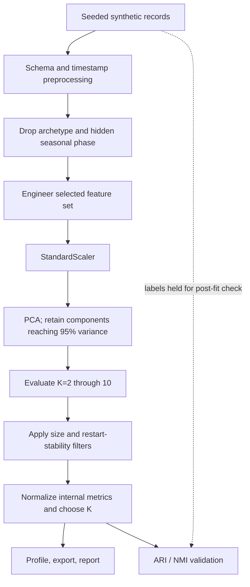

# Methodology

## Study design

The project has three distinct evidence paths:

1. **Controlled synthetic analysis:** seeded profiles with generator-defined archetypes. Labels are dropped before preprocessing and are used only after clustering to calculate recovery metrics.
2. **Measured-data analyses:** separate UCI and London scripts with dataset-specific transformations and coverage rules. These data do not provide behavioral labels, so outputs are descriptive/internal-stability analyses.
3. **Counterfactual load-shift scenarios:** assumptions about flexible fractions and destination windows. They are not observed responses or causal effect estimates.

Do not pool the results from these paths as if they had the same sampling frame or ground truth.

## Synthetic pipeline

The 365-day reference run uses 200 consumers, 51 behavioral features, 10 principal components, K=4, and seed 42. The default synthetic generator also supports shorter horizons; a setting is part of a run's configuration hash.

## Features

The behavioral feature set contains:

- 24 normalized hourly mean-load shares. Each consumer's hourly profile is divided by its total, so scalar changes in magnitude do not change this part of the representation.
- 27 derived timing, variability, and weekend descriptors.

The separate scale feature set contains magnitude summaries. The combined set is used for ablation. Feature groups and selectors are defined in `src/feature_engineering.py`.

## Preprocessing and PCA

Records are parsed and ordered within consumer. Missing values are handled within consumer boundaries. Outlier removal is configurable and defaults to preserving high values because high consumption can be behavior rather than a data error. StandardScaler is fitted before PCA. The retained component count reaches the configured cumulative variance threshold (0.95 in the reference configuration).

PCA loadings and cluster profiles support interpretation; neither is causal evidence.

## K selection and validation

For each candidate K, the pipeline records inertia, silhouette, Calinski–Harabasz, Davies–Bouldin, and restart stability. The current selection implementation in `src/clustering.py`:

1. Prefers candidates whose smallest cluster is at least 5% of consumers and whose mean pairwise restart ARI is at least 0.60.
2. Min-max scales silhouette and Calinski–Harabasz (higher is better) and Davies–Bouldin (lower is better), then averages the three scores.
3. Selects the smallest K within a 0.05 score tolerance of the best candidate.
4. Relaxes filters and records the relaxation if no candidate qualifies.

The tolerance and filters are heuristics, not statistical equivalence tests. Synthetic ARI/NMI are computed only after K-Means has been fitted. For measured data, only internal metrics, restart stability, temporal stability, and descriptive profiles are reported.

## Measured-data studies

### UCI ElectricityLoadDiagrams20112014

The repository copy is loaded by `research/run_uci_load_diagrams_validation.py`. The study samples client columns, excludes all-zero sampled clients, converts quarter-hour readings to hourly energy, and evaluates a 2012 period. A client is not assumed to be a household. Source citation, checksum, license, and command are in [the dataset notes](../dataset/real%20world/README.md).

### London SmartMeter

`research/run_london_household_validation.py` reads the partitioned source archive, chooses complete members, applies household coverage filters, and evaluates 2013. The available local archive was truncated; only 11 complete CSV members were analyzed. It is not a representative sample of the full dataset.

## Counterfactual scenario

The UCI scenario in `research/simulate_demand_response_uci.py` reassigns an assumed fraction of selected time-window energy to another window while preserving daily energy by construction. A same-fraction comparator is used. The scenarios compare arithmetic load profiles; they do not model customer utility, rebound, tariffs, costs, grid carbon intensity, or realized response.

The [interactive test-bench figure](visualizations.md) uses the saved UCI hourly profiles to show the target-cluster scenario and equal-energy comparator. Its slider interpolates only between the saved baseline and 10% endpoints; it does not refit clustering or introduce new data.

## Reproducibility

Use the scripts and commands linked in [the experiment index](experiments/README.md). Each study should be rerun when source data, transformations, selection settings, or dependencies change. Preserve its raw CSV/JSON sidecars, source checksum, seeds, and environment information.
\n