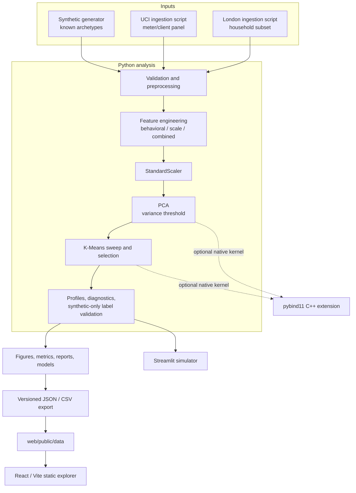
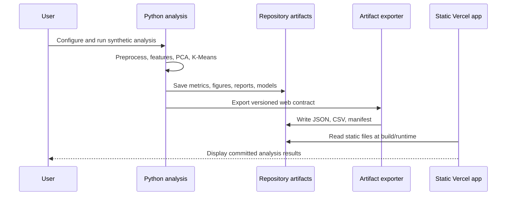
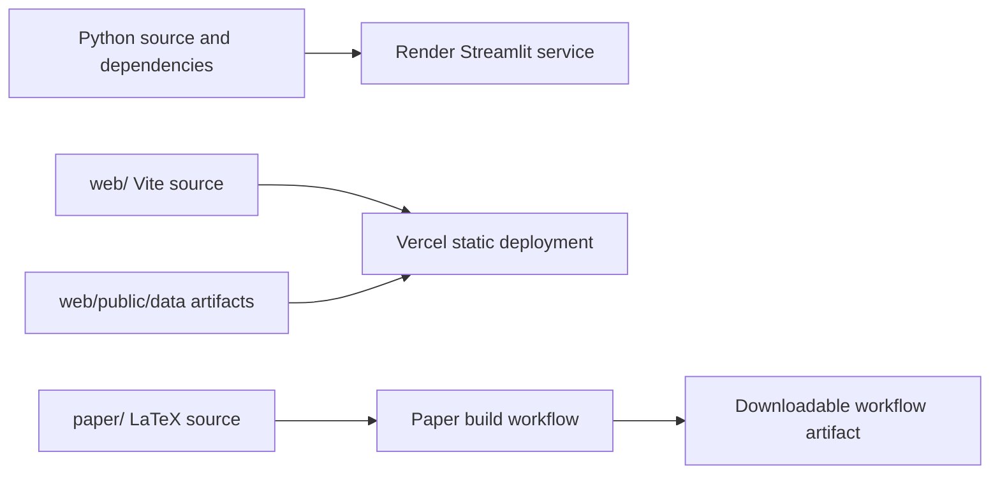

# Architecture

## System boundary

The repository contains an analysis pipeline, two user interfaces, research-specific measured-data scripts, and an optional native compute module. It is an exploratory research system. It does not ingest utility feeds, issue control commands, or operate demand-response programs.

## Current component architecture

The synthetic pipeline is orchestrated by `src/energy_analysis.py`. The measured-data experiments are separate scripts under `research/` because their source schemas and study assumptions differ from the generated reference run. Synthetic ground-truth labels are captured before they are dropped; they are only used after clustering for ARI/NMI validation.

The C++ extension supplies optional PCA and K-Means kernels through `src/cpp_bridge.py`. The Python/scikit-learn implementation is the reference path. If the extension is unavailable, the normal analysis still works.

## Data and artifact flow

The Vercel application reads the files in `web/public/data/` and never imports Python or fits a model. The Streamlit simulator runs the Python pipeline for the selected controls, caches results by configuration hash, and sends per-session output to a temporary directory.

## Deployment view

The Render and Vercel manifests are deployment configuration. The paper workflow builds a PDF artifact and does not write commits back to the repository.

## Interfaces and failure behavior

| Interface | Contract | Failure behavior |
|---|---|---|
| Analysis configuration | `AnalysisConfig` in `src/energy_analysis.py` | Invalid or unsupported values fail in the Python pipeline. |
| Research input | Local file path passed to a study script | Missing or malformed input stops that study; measured-data scripts do not silently substitute synthetic data. |
| Python/C++ bridge | NumPy arrays and sklearn-shaped result objects | `auto` falls back to Python; explicit C++ selection raises an availability error. |
| Python-to-web export | Versioned JSON/CSV files plus manifest | Missing optional metrics are represented as unavailable/null with reasons; the web app consumes static artifacts. |
| Streamlit | Sidebar controls and cached `AnalysisResults` | A run failure is shown by Streamlit; the app does not overwrite the committed reference outputs. |

## Repository layout

See the [root README](../README.md) for the top-level directory map. The most relevant source files are `src/energy_analysis.py`, `src/data_loader.py`, `src/preprocessing.py`, `src/feature_engineering.py`, `src/pca_analysis.py`, `src/clustering.py`, `src/export_artifacts.py`, and `streamlit_app.py`.

## Planned architecture

No future service or hardware integration is represented as implemented. Potential data connectors and inference APIs remain roadmap items until designed and validated.

