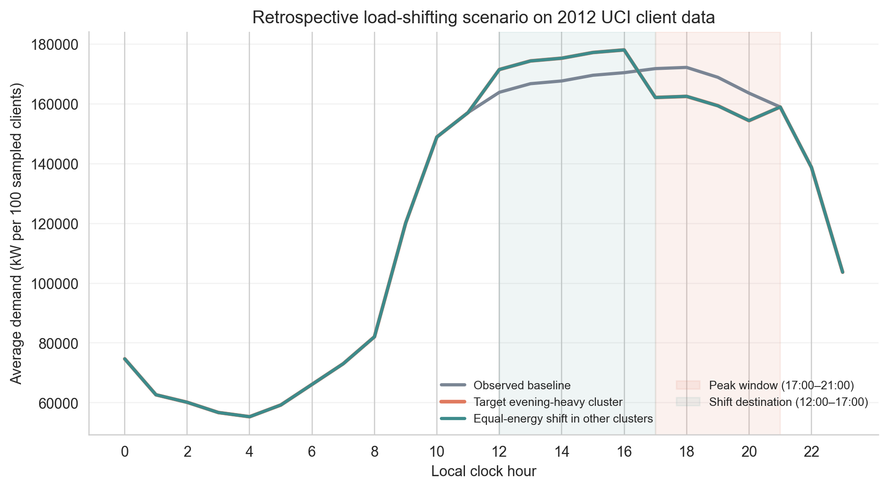

# Retrospective evening-peak load-shifting scenario

This is a transparent, assumption-driven simulation on the seeded 2012 UCI sample. It does not measure causal participant response, realized energy savings, or household flexibility. UCI identifies points/clients; they are not assumed to be households.

## Protocol

- Sample: 104 active clients after the same seeded 120-client draw and 16 all-zero exclusions.
- Clustering: 51 behavioral features, PCA retained at 95% variance, K selected by the predeclared rule (2 clusters).
- Target: cluster 1, with the highest mean per-client energy share from 17:00 to 21:00 (26.1%; n=14).
- Scenario: shift 10% of target-cluster 17:00–21:00 energy evenly into 12:00–17:00, preserving each typical day's total energy.
- Comparator: shift the same aggregate energy (39610.397 kWh across the sampled clients per average day) from the other clusters' evening window into the same destination period.
- Typical profiles are each client's average 24-hour kWh profile across 2012. Aggregate hourly kWh is interpreted as average kW over that hour.

## Scenario results

| Scenario | Shifted energy (kWh/day) | Evening peak (kW) | Evening peak change vs baseline | Whole-day peak (kW @ hour) | Daily energy change (kWh) |
|---|---:|---:|---:|---:|---:|
| observed_baseline | 0.000 | 179126.573 | 0.000 kW (0.00%) | 179126.573 @ 18:00 | 0.000000 |
| target_evening_heavy_cluster | 39610.397 | 169030.618 | 10095.956 kW (5.64%) | 185212.520 @ 16:00 | 0.000000 |
| equal_energy_non_target_comparator | 39610.397 | 169060.587 | 10065.986 kW (5.62%) | 185212.520 @ 16:00 | 0.000000 |

## Interpretation

Under the stated 10% flexibility assumption, the targeted scenario changes the sampled clients' 17:00–21:00 coincident peak by 10095.956 kW. The equal-energy shift among the other clusters changes it by 10065.986 kW, a nearly identical reduction. Both scenarios move the whole-day peak from hour 18 to hour 16 and raise its magnitude from 179126.573 to 185212.520 kW. This conditional engineering comparison on one anonymized client sample is not an estimate of actual demand response or bill savings; it also illustrates how a poorly chosen shift destination can create a new coincident peak.
The scenario preserves total daily energy by construction; it only moves load between hours.

## Reproducibility and limits

- UCI archive SHA-256: `f6c4d0e0df12ecdb9ea008dd6eef3518adb52c559d04a9bac2e1b81dcfc8d4e1`
- Repository source copy: dataset/real world/LD2011_2014.txt (SHA-256 d51565f2cb5a6b768d06ba1bbd3c084c6e2f3aab07f00c6f2dcb80e90175124b; CC BY 4.0)
- Sampling seed: 42; clustering seed: 42.
- Assumed target-cluster flexibility: 10% of its 17:00–21:00 energy.
- The UCI sample contains no appliance, occupancy, tariff-response, or flexibility labels.
- Results are retrospective and do not establish that cluster-based targeting causes a peak reduction in practice.
- Full metadata: `outputs/research_additions/demand_response_uci_2012.json`
- Hourly profile CSV: `outputs/research_additions/demand_response_uci_2012_hourly_profiles.csv`
- Figure: `outputs/figures/research_additions/demand_response_uci_2012.png`

