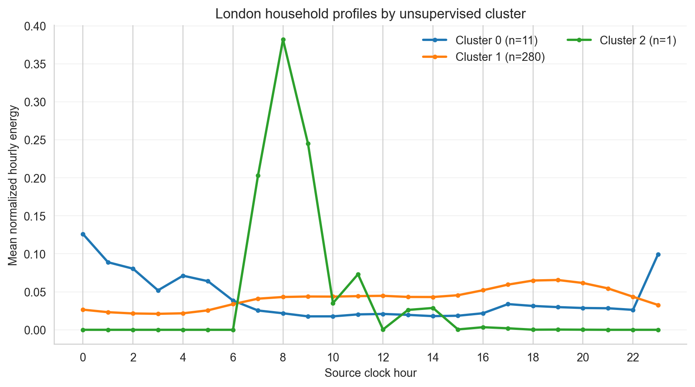
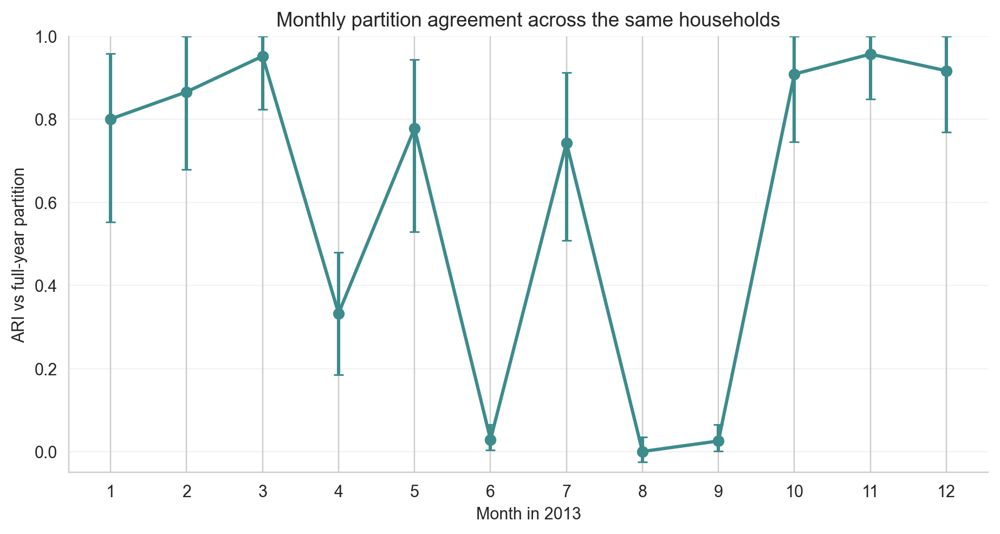
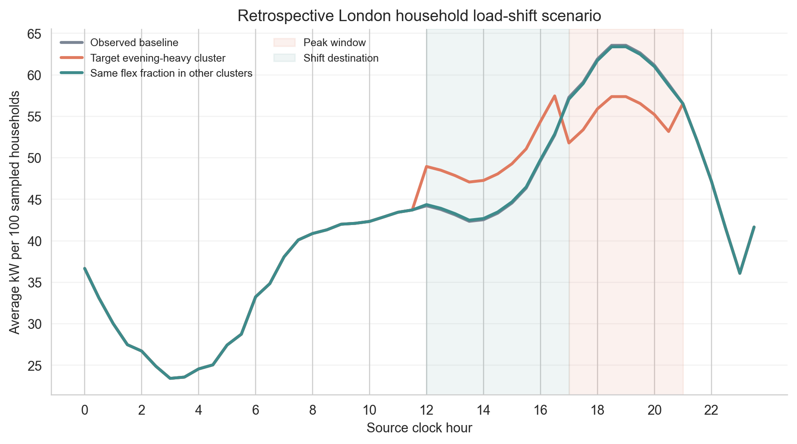

# London household validation and retrospective peak-shift scenario

The public dataset reports 5,567 households with half-hourly kWh readings. This run analyzes 292 seeded households from 11 complete CSV members of the archive. The archive download was truncated after those members; this subset is not a random draw from the full London population, so results are exploratory and should not be generalized to all 5,567 homes.

## Data and clustering protocol

- Period: calendar year 2013; 5,114,394 half-hour records, aggregated into 2,557,790 household-hours.
- Coverage: each retained household has at least 99.6% of expected half-hour readings and at least one reading in every month.
- Sample: uniform seeded sample without replacement (seed 42) from coverage-eligible households in the selected archive members.
- Features: 51 scale-invariant behavioral features; PCA retained 19 components (95.6% variance).
- K selection: candidates 2–8, 8 restart runs per K; selected K=3; silhouette=0.612.
- Restart stability at selected K: mean pairwise ARI 0.979.
- The data have no behavioral ground-truth labels; no ARI/NMI against invented labels is reported.

## Cluster profiles

| Cluster | Households | Share | Mean peak hour | Mean 18:00–24:00 share | Mean weekend ratio |
|---:|---:|---:|---:|---:|---:|
| 0 | 11 | 3.8% | 3.5 | 0.244 | 1.019 |
| 1 | 280 | 95.9% | 17.0 | 0.323 | 1.046 |
| 2 | 1 | 0.3% | 8.0 | 0.001 | 0.332 |

## Month-by-month partition agreement

Each month's 51-feature pipeline is refit on the same household IDs with annual K fixed. ARI measures agreement with the full-year partition, not ground-truth behavior. Bootstrap intervals resample households and are conditional on the selected members, annual K, and full-year assignment.

| Month | ARI vs full year | Household-bootstrap 95% CI |
|---:|---:|---:|
| 1 | 0.800 | [0.552, 0.958] |
| 2 | 0.866 | [0.679, 1.000] |
| 3 | 0.952 | [0.824, 1.000] |
| 4 | 0.333 | [0.185, 0.479] |
| 5 | 0.778 | [0.529, 0.943] |
| 6 | 0.029 | [0.004, 0.065] |
| 7 | 0.743 | [0.508, 0.913] |
| 8 | 0.000 | [-0.024, 0.035] |
| 9 | 0.026 | [0.002, 0.065] |
| 10 | 0.908 | [0.745, 1.000] |
| 11 | 0.957 | [0.848, 1.000] |
| 12 | 0.916 | [0.768, 1.000] |

## Retrospective load-shifting scenario

The evening-heavy cluster was selected by its highest mean household share of 17:00–21:00 energy. The targeted scenario shifts 10% of that cluster's energy in this window evenly into 12:00–17:00. The comparator applies the same 10% fraction to the other clusters, so aggregate kWh shifted can differ. Both preserve daily energy by construction and do not estimate actual response or savings.

| Scenario | Shifted energy (kWh per average day) | Evening peak (kW) | Evening peak change | Reduction per MWh shifted (kW) | Whole-day peak (kW) | Whole-day peak hour | Daily energy change (kWh) |
|---|---:|---:|---:|---:|---:|---:|---:|
| observed_baseline | 0.000 | 185.602 | 0.000 kW (0.00%) | 0.000 | 185.602 | 19.0 | 0.000000 |
| target_evening_heavy_cluster | 69.163 | 167.553 | 18.049 kW (9.72%) | 260.967 | 167.787 | 16.5 | 0.000000 |
| same_fraction_non_target_comparator | 2.109 | 185.092 | 0.511 kW (0.28%) | 242.124 | 185.092 | 19.0 | 0.000000 |

Under the assumed flexibility, the targeted scenario changes the sampled households' evening coincident peak by 18.049 kW and the same-fraction comparator changes it by 0.511 kW. Compare peak change per MWh shifted because aggregate shifted energy differs. The scenario is conditional on an assumed shift and is not evidence that consumers can or will deliver it.

## Reproducibility and limits

- Official dataset: [SmartMeter Energy Consumption Data in London Households](https://data.london.gov.uk/dataset/smartmeter-energy-consumption-data-in-london-households-vqm0d); license: Creative Commons Attribution.
- Selected member names, member hashes, household IDs, coverage checks, archive size/hash, and transformations are recorded in `outputs/research_additions/london_household_validation_2013.json`.
- Raw meter data are not redistributed in this repository.
- The archive prefix contains members 0, 1, 10, and 100–107 only; this subset does not support population-level claims.
- All clusters remain unlabeled; their descriptions are load-shape summaries only.
- Demand response is a counterfactual shift simulation; it does not estimate tariff effects, actual savings, or flexibility.

## Figures

