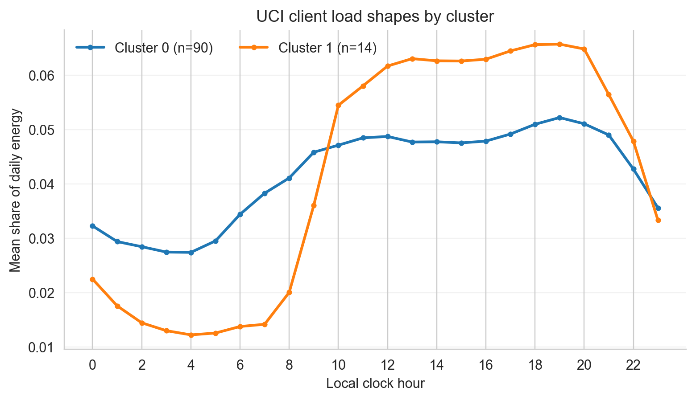

# Real-world validation report: UCI ElectricityLoadDiagrams20112014

_No ARI/NMI is reported here: real data has no ground-truth archetype. Scores are internal quality + restart stability + temporal stability only._

- Meters: 104
- Records (meter-hours): 913,536
- Features per meter: 51
- PCA components kept: 11 (95.5% variance)
- K selected: 2  (candidates 2-8)

## Internal quality (higher silhouette / CH is better; lower DB is better)

| Metric | Value |
|--------|-------|
| Silhouette @ K=2 | 0.4662 |
| Calinski-Harabasz @ K=2 | 37.6 |
| Davies-Bouldin @ K=2 | 0.9081 |

## Restart stability (mean pairwise ARI over K-Means seeds @ K)

- Seed-stability ARI: 1.0000 (1.0 = identical partition every restart)
- Temporal stability (partitions across 3 time windows): mean pairwise ARI 0.2884

## Cluster interpretability

| Cluster | Share | Mean individual peak hour | Evening share | Peak-to-avg | CV | Weekend ratio |
|---------:|------:|----------:|--------------:|-----------:|----:|--------------:|
| 0 | 87% | 16.6 | 28% | 2.33 | 0.39 | 0.99 |
| 1 | 13% | 18.5 | 33% | 2.83 | 0.65 | 0.96 |

## Data provenance and protocol

- Dataset: Real 15-minute electricity consumption for 370 anonymized points/clients; the source does not establish that every client is a household.
- Citation: Trindade, A. (2015). ElectricityLoadDiagrams20112014 [Dataset]. UCI Machine Learning Repository. https://doi.org/10.24432/C58C86.
- Source: https://archive.ics.uci.edu/dataset/321/electricityloaddiagrams20112014
- License: Creative Commons Attribution 4.0 International (CC BY 4.0)
- Raw archive SHA-256: `f6c4d0e0df12ecdb9ea008dd6eef3518adb52c559d04a9bac2e1b81dcfc8d4e1`
- Window: 2012-01-01 to 2012-12-31 (inclusive)
- Sampling: uniform sample without replacement from UCI client columns; n=104, seed=42
- Zero-consumption sampled clients excluded: 16
- Conversion: quarter-hour mean kW divided by four to kWh, then four intervals summed per local-clock hour; timestamps are assumed to mark interval ends.
- Limitation: UCI identifies points/clients, not residential households; there are no behavioral labels, so this is an unsupervised stability and interpretability analysis rather than ground-truth recovery.

